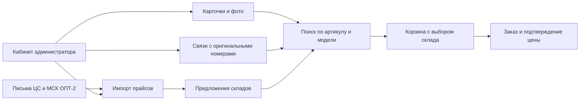

# Склады и карточки веб-каталога

NestJS обслуживает публичную витрину и кабинет администратора. PostgreSQL хранит одну карточку на артикул и отдельное предложение каждого склада. React использует те же карточки в поиске, корзине и оформлении заказа.

## Условия склада и заказа

- `Product` хранит артикул, название, описание и до четырёх ссылок на фото. К артикулу привязаны проверенные применения по маркам и моделям. Первое фото также доступно клиенту Telegram Mini App.
- `Warehouse` описывает склад, доплату к базовой наценке, партию по умолчанию и отбор по бренду. `WarehouseOffer` хранит цену за единицу, остаток и кратность для пары «карточка и склад». Для ЦС сохраняется розничная цена из существующего расчёта, для МСК ОПТ-2 — закупочная цена из прайса. В магазине оператор вводит розничную цену.
- При базе 14% цена ЦС из закупки 100 ₽ составляет 114 ₽. Цена МСК ОПТ-2 при той же закупке составляет 116 ₽. При остатке меньше партии карточка показывает «Под заказ».
- Одинаковый артикул можно добавить двумя строками с разных складов. API сверяет цену, остаток и кратность на выбранном складе. Для складов, которые обновляются файлом, менеджер подтверждает возможность поставки перед оплатой. Перед созданием ссылки на оплату сервер снова проверяет актуальные условия. При смене суммы покупатель подтверждает её заново.
- Настройка `AVTOLIGA_CS_STORE_ID` задаёт точный идентификатор ЦС из ответа Avtoliga. После настройки проверка ЦС выполняется через API этого склада. До настройки веб-заказы с выбором ЦС проходят подтверждение менеджером по условиям ЦС.

Миграция заполняет предложения ЦС текущими значениями каталога. Импорт ЦС обновляет предложение для сайта и поля, которые читает Telegram Mini App. Его существующие корзины и заказы используют прежний сценарий. Старые веб-заказы открываются с сохранёнными строками.

## Кабинет

Откройте `/?catalog-admin=1` и войдите с действующим ключом администратора. «Карточки» позволяет найти и создать товар, поменять название и описание, указать оригиналы, фото, розничную цену и остаток склада магазина. Номер существующей карточки служит постоянным ключом для заказов, применяемости и импорта. «Склады и прайсы» показывает историю и позволяет добавить склад и загрузить прайс. «Аналоговые з/ч» принимает таблицу связей и выгружает её в XLSX.

### Формат прайса

XLS, XLSX или CSV в UTF-8. Сохраняйте артикулы как текст, особенно номера с ведущим нулём. Артикул сопоставляется целиком, с учётом суффиксов и внутренних знаков. Пробелы по краям и регистр букв при сопоставлении приводятся к одному виду.

| Колонка | Содержимое |
| --- | --- |
| Артикул | Полный артикул детали |
| Наименование | Название для новых карточек |
| Цена | Закупочная цена за единицу. Для склада магазина это цена покупателя |
| Остаток | Количество в штуках |
| Минимальная партия | Кратность заказа. При отсутствии берётся настройка склада |
| Бренд | Для МСК ОПТ-2 принимаются строки CHERY или ЧЕРИ |
| Артикул оригинала | Необязательная явная связь для аналоговой детали |

Обычная загрузка обновляет строки из файла. «Полный снимок склада» снимает с продажи предложения этого склада, которых нет в выгрузке. Если выгрузка содержит меньше половины ранее активных позиций склада, импорт полного снимка отклоняется. Импорт применяет данные и записывает результат в `PriceImport` в одной транзакции. На сервере с Nginx лимит тела запроса для загрузок должен покрывать файл до 8 МБ и поля формы.

### Связи аналогов

| Артикул оригинала | Артикул аналога |
| --- | --- |
| OEM-001AA | ALT-001 |
| OEM-002AB | ALT-001 |
| OEM-001AA | ALT-002 |

Связь можно передать при загрузке прайса, импортировать отдельной таблицей или задать в карточке вручную. Для отдельной таблицы карточка аналога должна уже существовать. Оригинал может отсутствовать в продаже. Граф связей хранится в `OriginalArticle`. При поиске полного оригинального номера витрина выводит «Аналоговые з/ч». Для связи из спорной таблицы поставщика сначала сверяется полный номер с каталогом изготовителя. Применяемость оригинала к конкретному автомобилю проверяется отдельно.

## Подключение МСК ОПТ-2

1. Сверьте настоящий XLS/XLSX и письмо. Проверьте строку заголовков, марку CHERY, наличие и значение партии 1. Сначала файл можно загрузить через кабинет.
2. В действующем окружении почты укажите `PRICE_MSK_OPT2_ENABLED=true`, `PRICE_MSK_OPT2_MAIL_SUBJECT` и при необходимости `PRICE_MSK_OPT2_MAIL_FROM`. По умолчанию отбор идёт по теме «МСК ОПТ-2» и отправителю ЦС. Для выбора среди вложений задайте `PRICE_MSK_OPT2_MAIL_ATTACHMENT`.
3. Если нужно указать лист и точные названия колонок, доступны `PRICE_MSK_OPT2_SHEET` и `PRICE_MSK_OPT2_COL_CODE`, `_COL_PRICE`, `_COL_STOCK`, `_COL_PACK`, `_COL_BRAND`, `_COL_NAME`. Обе рассылки читаются через существующий IMAP с доступом только на чтение. Свежесть и журнал импорта считаются отдельно для каждого склада.

## Прайсы из почты в кабинете

На вкладке «Склады и прайсы» откройте «Прайсы из почты». Здесь видны активные правила и свежие темы от настроенного поставщика. В истории можно выбрать склад. Письмо без активного правила отображается в списке тем. Запись о загрузке появляется после обработки вложения.

Выберите склад и введите постоянную часть темы письма. Дату уберите из правила, чтобы подходили последующие рассылки. «Проверить последнее письмо» показывает файл, листы, заголовки и число позиций. При нескольких вложениях укажите часть имени нужного. Для файла с остатками нескольких складов укажите колонку выбранного склада.

«Загрузить и включить автоимпорт» применяет проверенное вложение и сохраняет правило для будущих писем с тем же форматом. ЦС CHERY, МСК ОПТ-2 и Geely ЦС ведут отдельную историю. Почтовое подключение использует существующие IMAP-настройки и адрес поставщика на сервере.
